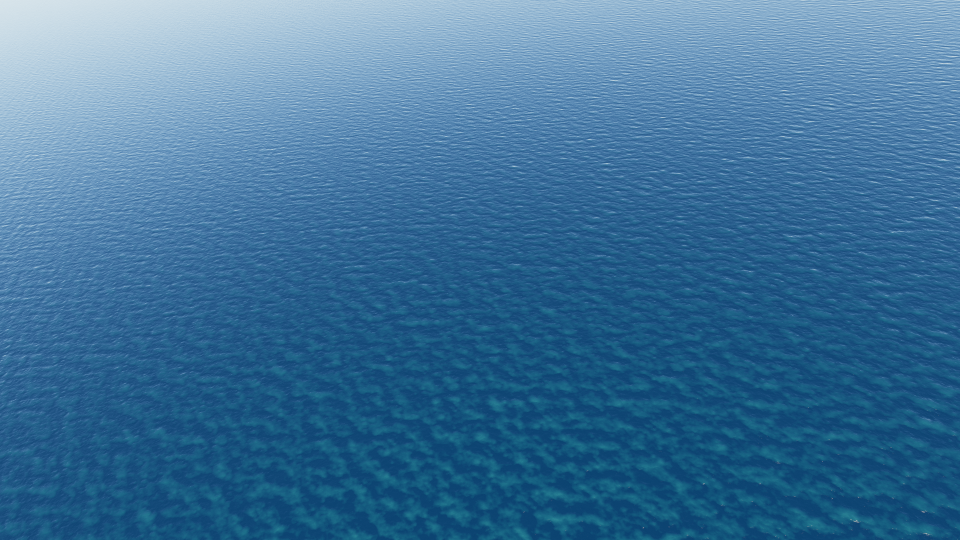
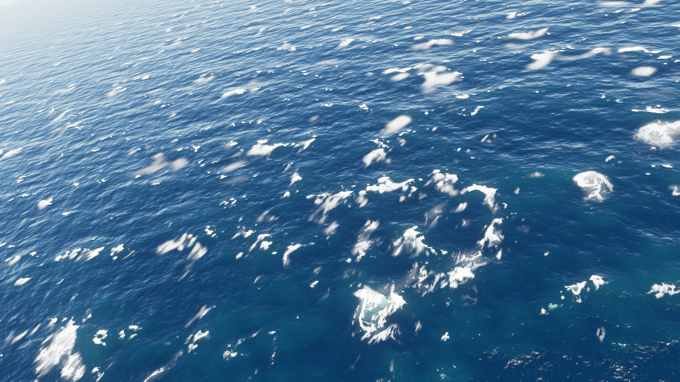

# mare-realtime

Simulated UAV flights over a simulated ocean, for building datasets: a fixed-wing
aircraft flies a pattern through wind and turbulence, and for every run you get its
trajectory and IMU, the onboard camera's view of the sea along it, and the camera pose
and intrinsics of every frame — across as many sea states, skies and flight patterns as
you care to sweep.

| calm (U10 3 m/s, Hs 0.23 m) | strong (U10 12 m/s, Hs 2.81 m) |
| --- | --- |
|  |  |

*Onboard frames 30 of two runs of `jobs/conditions-grid.json` (loiter at 150 m, midday
sun, gimbal 35° down). The numbers are the simulator's, not measurements of a real sea.*

**What it is, and what it is not.** The ocean is a real-time, rasterised approximation:
a spectral (JONSWAP) sea synthesised by GPU FFTs in three.js / WebGL2, with foam, sky,
haze and a camera exposure model, rendered at tens of frames a second. It is meant to be
fast and controllable, not physically exact. Its offline sibling, `../mare`, path-traces
the sea for reference-quality frames. The engine in `src/ocean/` was extracted from Tera
AI's presentation deck and made drivable frame by frame for data generation.

## Quick start

Requirements: Node 22 or newer, pnpm, a GPU with WebGL2 (any recent Mac, or a desktop
GPU), and for datasets a Chromium that Playwright can drive. `ffmpeg` on the `PATH` is
optional (for `--video`).

```sh
pnpm install
pnpm exec playwright install chromium   # once; see "Chromium" below
pnpm dev                                 # the app, on http://localhost:5173/
```

The app is where you design a run:

- **Conditions**: a sea preset or your own wind speed, direction, fetch, swell and
  choppiness; a sky preset or your own sun, cloud and haze. The panel shows the simulated
  significant height, peak period and Beaufort force as you change them.
- **Trajectory**: pattern and its parameters, altitude and altitude profile, airspeed,
  wind (from the sea, none, or given), turbulence, gimbal, start, seed and duration
  (up to 900 s in the app).
- **View**: chase, onboard or overhead camera; trajectory, footprint, grid, horizon and
  flow overlays; the label channels (`Render`); and a timeline to play, pause, scrub and
  speed up the flight (Space plays and pauses, `h` hides the panel, `g` takes the camera:
  drag to look, scroll to zoom).
- **Export**: the run's id, render size, frame rate, warm-up, channels and IMU rate;
  **Download run.json** (feed it to the generator), **Download trajectory.csv**, and
  **Import run.json**. The URL hash holds the whole run, so a link reproduces it.

The app's chase preview is the batch's chase shot, with the aircraft moved clear of the
panel; the onboard preview is the batch's onboard camera.

## Generating a dataset

```sh
node scripts/generate.mjs jobs/quick.json                      # one 10 s run, 51 small frames
node scripts/generate.mjs run.json --out out                   # a run.json from the app
node scripts/generate.mjs jobs/conditions-grid.json --limit 3 --video
```

The generator expands the job in node, flies each run's trajectory and writes its IMU
in node, and renders the frames in headless Chromium on the GPU (`batch.html`, driven
by Playwright). It starts its own vite server on `--port` (hot reload off) unless given
`--url`, and stops it however it exits.

| flag | |
| --- | --- |
| `--out <dir>` | output root (default `out`); runs go in `<out>/<job>/<run-id>/` |
| `--url <url>` | use this running server instead of starting vite |
| `--port <n>` | port for the vite it starts (default 5174, strict: fails if taken) |
| `--only <text>` | only runs whose id contains this |
| `--limit <n>` | at most this many runs (after `--only`) |
| `--no-frames` | flight only (run.json, trajectory.csv, imu.csv, meta.json): no browser |
| `--video` | also encode the shaded frames to `video.mp4` with ffmpeg |
| `--software` | render on SwiftShader instead of the GPU (slow; for machines without one) |
| `--concurrency <n>` | runs rendered at once, each in its own page (default 1) |
| `--force` | redo runs that are already complete on disk |

A run whose directory already holds a complete `meta.json` for the same `run.json` is
skipped, so an interrupted job resumes where it stopped. The exit code is 1 if any run
failed (each is marked `failed` with its error in `meta.json` and `index.csv`), 2 for
bad arguments (unknown flags included), 130 when interrupted by SIGINT or SIGTERM: the
browser and ffmpeg are stopped, `index.csv` is written, and the runs cut short are
listed as `pending` (not failed) and redone next time. A second Ctrl-C exits at once.
`--video` writes `video.mp4` only once ffmpeg has finished, and a later `--video` makes
the video of any complete run that lacks one (or whose encode failed), recording it in
`meta.json`.

On an Apple M5 a 1280×720 frame takes about 4 ms to render and about 30 ms to encode as
PNG, so a page renders about 23 frames/s; `--concurrency 2` roughly doubles that. A
1280×720 PNG of a moderate sea is about 2 MB (2.1–2.3 MB measured), so a minute at 5 fps
is about 650 MB per mode.

Frames are limited to what the browser will allocate as one drawing buffer: Chromium
caps it near 2²⁵ pixels, so 7680×4320 works and 8192×4096 does not. A run asking for
more fails with that message instead of writing cropped frames.

### Job files

A job is a base run plus what varies (see `jobs/`):

```json
{
  "name": "sea-state-sweep",
  "description": "Every wind sea from glassy to gale under a high and a low sun.",
  "base": {
    "trajectory": { "duration": 60, "altitude": 120, "airspeed": 32, "pattern": "survey" },
    "render": { "fps": 5 }
  },
  "sweep": {
    "sea": ["glassy", "calm", "light", "moderate", "fresh", "strong", "gale"],
    "light": ["midday", "low-sun"]
  }
}
```

- `sweep` is a grid: every combination is a run, the last key varying fastest. Keys are
  dotted paths into the run (`trajectory.altitude`, `sea.swellHeight`,
  `trajectory.gimbal.pitch`); `sea`, `light` and `trajectory.pattern` also take preset
  names, and a path through a preset (`sea.windDirection` on top of `"sea": "moderate"`)
  starts from that preset's values. `seed` sets `trajectory.seed` and the sea's seed
  (`render.seaSeed = 20240611 + seed`) together: another flight over another, statistically
  identical sea.
- `random: { "count": 100, "seed": 7 }` draws domain-randomised runs: wind 2–20 m/s
  toward any direction, fetch 50–800 km, a swell three times in four (0.1–2.5 m, 8–16 s,
  within 90° of the wind), choppiness 0.6–1.4; sun from 4° below the horizon to 65° up at
  any azimuth, cloud and haze within rules that keep the frame worth looking at;
  altitude 30–400 m (log-uniform), airspeed 18–32 m/s (raised to at least 1.3 × the
  wind at that altitude, so the aircraft can always fly its pattern), gimbal 15–80° down,
  fov 35–75°,
  stabilisation 0.3–1, turbulence 0–0.8, any start heading, any pattern preset. With both
  `sweep` and `random`, the random runs follow the grid's.
- Run ids are stable: `<job>-<index>-<tokens>`, e.g.
  `conditions-grid-002-calm-midday-loiter-s1`; only axes with more than one value add a
  token.

A **run** (`run.json`) is one flight over one ocean. Everything has a default, so `{}`
is a valid run (moderate sea, morning sky, a 60 s straight transit at 120 m); the
generator writes the fully resolved run back into each run directory, so a run can be
repeated from its own file. Unknown fields and presets are errors that name the field.

```json
{
  "id": "my-run",
  "sea": "fresh",
  "light": { "sunElevation": 15, "sunAzimuth": 240, "overcast": 0.2, "haze": 0.3 },
  "trajectory": {
    "seed": 3, "duration": 120, "altitude": 150, "pattern": "survey",
    "altitudeProfile": { "type": "sine", "amplitude": 10, "period": 40 },
    "airspeed": 24, "turbulence": 0.3, "wind": "sea",
    "start": { "x": 0, "y": 0, "heading": 45 },
    "gimbal": { "pitch": -35, "yaw": 0, "fov": 48, "stabilized": 0.55 }
  },
  "render": {
    "width": 1280, "height": 720, "fps": 10, "quality": "high",
    "modes": ["shaded", "height"], "view": "onboard",
    "warmup": 8, "seaTime": 0, "seaSeed": 20240611, "frames": true
  },
  "imuRate": 200,
  "origin": { "lat": 43.3, "lon": 5.3 }
}
```

`render.modes` is any of `shaded`, `height`, `velocity`, `normals`, `foam`, `depth`;
`render.view` is `onboard` (the gimbal camera) or `chase` (24 m behind the aircraft's
right quarter, 12° above, aircraft centred). `warmup` is how long the sea and its foam run
before frame 0 (the flight is held at t = 0 meanwhile). `origin` adds latitude and
longitude columns.

### Output

```
out/<job>/index.csv                 every run of the job: complete, failed or pending
out/<job>/<run-id>/
  run.json                          the run, fully resolved
  meta.json                         status, sea stats, wind aloft, seeds, GPU, versions, timings (written last)
  trajectory.csv                    one row per frame
  imu.csv                           one row per IMU sample, t = 0 … duration at imuRate
  frames.csv                        the camera of every frame (needs the render)
  frames/000000.png                 the shaded onboard (or chase) frame
  frames/<mode>/000000.png          one folder per label mode
  video.mp4                         with --video
```

Frame `i` is the flight at `t = i / fps`, for `i = 0 … floor(duration · fps)`. The sea's
own clock at frame `i` is `render.seaTime + render.warmup + t`.

**trajectory.csv**: `frame, t, x, y, altitude, vE, vN, vU, heading, course, pitch, bank,
turnRate, airspeed, groundSpeed, windE, windN, windU, fx, fy, fz, p, q, r, gimbalPitch,
gimbalYaw, gimbalFov` (+ `lat, lon` with an origin). `windE/N/U` is the wind at the
aircraft including gusts; `fx…r` are the IMU's values at that instant. With
`--no-frames` the rows are at exactly `i / fps`; with frames, `t` is the time the frame
was drawn at (a float sum of the steps, within a few ulps of `i / fps`). Either way the
rows are computed in node, like imu.csv.

**imu.csv**: `t, fx, fy, fz, p, q, r` — specific force (m/s²) and body rates (rad/s).

**frames.csv**: `frame, t, seaTime, cam_e, cam_n, cam_u, R00, R01, R02, R10, R11, R12,
R20, R21, R22, qx, qy, qz, qw, fx, fy, cx, cy, width, height, fovY, heightAboveSea,
seaHeightUnderCamera, aircraft_x, aircraft_y, aircraft_altitude, aircraft_heading,
aircraft_pitch, aircraft_bank` (+ `cam_lat, cam_lon, aircraft_lat, aircraft_lon` with an
origin). These are read off the camera the engine actually drew with, after drawing.

**index.csv**: `id, status, summary, sea_hs, sea_tp, beaufort, wind_speed,
sun_elevation, pattern, altitude, frames, rendered, seconds, path, error`.

All CSVs are plain decimals (no exponents), 6 places (9 for rotations, quaternions and
lat/lon; index.csv, a summary, 4), `\n` line endings, a header row.

### Coordinate conventions

- **World**: metres in a local east / north / up frame on the mean sea surface: `x` (or
  `cam_e`) east, `y` north, `altitude` / `cam_u` up above mean sea level.
- **Directions**: compass degrees, 0 = north, 90 = east, clockwise. Wind and sea
  directions are where they travel **toward**, not the meteorological "from".
- **Aircraft attitude**: `heading` of the nose, `pitch` nose-up positive, `bank`
  right-wing-down positive (yaw–pitch–roll, Z-Y-X). `course` is the ground track; in a
  cross wind the nose crabs into the wind and the two differ.
- **IMU**: body frame FRD (x forward, y right wing, z down). Specific force `f = a − g`,
  so level, unaccelerated flight reads `fz ≈ −9.81`. `p, q, r` are rad/s about x, y, z.
- **Camera**: OpenCV axes (x right, y down, z along the optical axis). `R_wc` (row-major
  `R00…R22`, and the same rotation as the quaternion `qx, qy, qz, qw`, `qw ≥ 0`) takes
  camera-frame vectors to ENU; `cam_e, cam_n, cam_u` is `t_wc`. A world point `P`
  projects as `p_c = R_wcᵀ (P − t_wc)`, `u = fx · p_c.x / p_c.z + cx`,
  `v = fy · p_c.y / p_c.z + cy`, pixel (0, 0) being the top-left corner of the top-left
  pixel. The camera is an ideal pinhole: no distortion, square pixels, principal point at
  the image centre, `fx = fy`.
- **Time**: `t` is seconds since the start of the flight.
- `lat, lon` (with `origin`): the world is the local tangent plane at the origin on the
  WGS-84 ellipsoid; a point's latitude and longitude are those of its point on that plane
  (through earth-centred coordinates, exact). The simulated sea itself is flat, so far
  from the origin the plane rises above the ellipsoid (about 2 m at 5 km).

## Presets

### Seas

Every preset sea travels toward 60°. Hs, Tp and the wavelength at Tp are computed from
the simulated spectrum (`seaStats` in `src/ocean/spectrum.js`), so they describe what is
rendered.

| preset | U10 m/s | fetch km | swell | Hs m | Tp s | λp m | Beaufort |
| --- | --- | --- | --- | --- | --- | --- | --- |
| `glassy` | 1 | 400 | — | 0.03 | 0.7 | 1 | 1 |
| `calm` | 3 | 400 | — | 0.23 | 2.2 | 8 | 2 |
| `light` | 5 | 400 | — | 0.64 | 3.7 | 22 | 3 |
| `moderate` | 7 | 400 | — | 1.25 | 5.2 | 43 | 4 |
| `fresh` | 9.5 | 400 | — | 2.31 | 7.1 | 79 | 5 |
| `strong` | 12 | 150 | — | 2.81 | 7.6 | 90 | 6 |
| `gale` | 18 | 300 | — | 5.94 | 10.9 | 187 | 8 |
| `moderate-swell` | 7 | 400 | 1.5 m, 13 s, toward 75° | 1.96 | 13.0 | 264 | 4 |
| `cross-swell` | 7 | 400 | 1.8 m, 11 s, toward 140° | 2.19 | 11.0 | 189 | 4 |
| `calm-swell` | 3 | 400 | 1.2 m, 14 s, toward 30° | 1.22 | 14.0 | 306 | 2 |

Hs is of the combined sea; Tp is the peak of the combined spectrum (the swell's, where
there is one). `strong` is fetch-limited, the others fully developed at their fetch.
A sea can also be given in full: `windSpeed`, `windDirection`, `fetch` (km), `spread`,
`swellHeight`, `swellDirection`, `swellPeriod`, `choppiness`.

### Skies

| preset | sun elevation | sun azimuth | overcast | haze |
| --- | --- | --- | --- | --- |
| `midday` | 60° | 180° | 0.05 | 0.15 |
| `morning` | 22° | 110° | 0.15 | 0.3 |
| `low-sun` | 7° | 250° | 0.1 | 0.35 |
| `overcast` | 35° | 160° | 0.85 | 0.45 |
| `hazy` | 30° | 200° | 0.25 | 0.75 |
| `dusk` | −3° | 290° | 0.2 | 0.35 |

### Patterns

Lengths in metres. Pattern geometry is laid out from the start point along the start
heading: a pair such as an orbit `center` or a waypoint is `[right, ahead]` of the start
heading (`[east, north]` when it is 0). `direction: 1` is clockwise seen from above.

| type | parameters (trajectory defaults) | preset |
| --- | --- | --- |
| `straight` | — | `transit` |
| `orbit` | `radius` 180, `direction` 1, `center` [direction · radius, 0] | `loiter`: radius 250 |
| `racetrack` | `length` 600, `radius` 150, `direction` 1 | `racetrack`: 900 / 200 |
| `figure8` | `radius` 150 | `figure8`: radius 250 |
| `lawnmower` | `legLength` 800, `spacing` 120, `legs` 6 | `survey`: 900 / 200 / 4 legs |
| `waypoints` | `points` [[right, ahead] or [right, ahead, altitude], …], `loop` true | — |
| `random` | `legLength` [300, 900], `turn` [−120, 120] (signed, positive right) | `random`: turns [−150, 150] |

The flight is simulated, not drawn: an L1 guidance law flies the pattern with a
coordinated-turn autopilot (bank ≤ 35°, roll rate ≤ 45°/s), climb and sink ≤ 5 m/s,
airspeed through a lag. Ground velocity is air velocity plus the wind, so the aircraft
crabs; turbulence (0–1) is a seeded, band-limited gust field on the wind and the
attitude. Turns stay coordinated when climbing or descending, and the flight path
bends at a limited pitch acceleration, so the IMU has no steps at an altitude change.
The flight starts trimmed: on the start heading as its ground course, crabbed into the
wind, already banked if the pattern starts in a turn (a waypoint not straight ahead is
then turned onto). `airspeedVariation` is the size of a slow wander: its RMS is that of a
sine of that amplitude, and over minutes its peaks reach 1.5–2 times it. A trajectory
whose mean wind at cruise is 0.9 × its airspeed or more cannot fly its pattern (it drifts
downwind); it is flagged in the app, the generator's log and `meta.json` (`warnings`). Altitude profiles:
`constant`, `sine` (`amplitude`, `period`), `steps` (`amplitude`, `interval`: seeded
climbs and descents). Wind: `"sea"` (the sea's U10 carried up to altitude by a log
profile over open water), `"none"`, or `{ "speed", "direction" }` at altitude.

## Using the modules directly

`src/trajectory/` and `src/conditions/` are pure JavaScript and run in node:

```js
import { createTrajectory, samplesToCsv } from './src/trajectory/index.js';
import { resolveRun, expandJob } from './src/conditions/index.js';

const run = resolveRun({ sea: 'fresh', trajectory: { pattern: 'loiter', duration: 300 } });
const traj = createTrajectory(run.trajectory, { sea: run.sea });
traj.stateAt(12.5);              // a TrajectorySample at any t
samplesToCsv(traj.sample(50));   // 50 Hz, the trajectory.csv columns
```

The engine's manual mode (`advance`, `renderFrame`, `frameTruth`, `capture`) and every
module contract are in [docs/ARCHITECTURE.md](docs/ARCHITECTURE.md).

## Determinism

- **Trajectories, IMU and job expansion** are pure functions of the spec: seeded PRNGs
  only, no clock. The same run gives bit-identical samples on the same JS engine build.
  Node and a browser agree to about 1e-12, identical at the CSVs' precision, but not to
  the bit (their `Math.sin`, `exp`, `atan2`… may differ in the last place); the generator
  writes trajectory.csv and imu.csv from node, and only frames.csv's aircraft columns
  come from the browser. Job expansion gives identical runs in both.
- **Frame rate**: the engine steps the sea and its foam at most 0.1 s at a time, so the
  same sea time gives the same sea at any fps.
- **Frames**: the manual engine reads no clock and draws no random numbers, so the same
  run on the same GPU, driver and browser build gives byte-identical PNGs and CSVs
  (verified on an Apple M5 with ANGLE Metal by re-rendering into a fresh output folder).
  On another GPU or driver the PNGs differ slightly (FFT precision, MSAA, mipmaps);
  `meta.json` records the GPU and the versions.
- The sea's seed (`render.seaSeed`) fixes its Gaussian field: the same seed and sea time
  give the same waves whatever the flight.

## Chromium

The generator and the e2e tests use Playwright's own Chromium if it is installed
(`pnpm exec playwright install chromium`), else the newest one in Playwright's cache, or
the browser named by `MARE_CHROMIUM`. They launch it with the platform's GPU flags
(`--use-angle=metal` on macOS; `d3d11` on Windows and `vulkan` on Linux, untested);
`--software` uses SwiftShader, which works anywhere but renders a few frames a second.

## Development

```sh
pnpm check       # tsc over the JSDoc types (src, scripts, tests, e2e)
pnpm test        # node:test unit tests (also: node --test tests/)
pnpm test:e2e    # the batch page on the GPU (vite on MARE_E2E_PORT, default 5175)
pnpm build       # the app and the batch page into dist/
```

## Limits

- **An approximation.** The sea is a linear spectral sea with a choppiness
  displacement, rasterised in real time; foam, spray, sky and haze are models tuned to
  look right, not radiometry. Use `../mare` for path-traced frames.
- **The sea repeats**: in time every 1200 s (wave frequencies are quantised so the
  animation loops), and in space over the largest FFT patch (about 1 km).
- **Height above the sea** (`seaHeightUnderCamera`, `heightAboveSea`) is read off the
  GPU sea the frame was drawn from: every FFT cascade at full resolution, at the point
  of the (sideways-displaced) surface straight below the camera. Against the height
  channel drawn at the nadir pixel it is within 1 cm RMS at 40 m, 2 cm at 150 m and
  6 cm at 400 m over a gale, where the drawn surface fades its finest waves with
  distance. (The app's live height readout still uses a CPU sampler of the longest
  waves, which misses most of the lighter seas' waves.)
- **Label channels are colourised images**, not raw values: 8-bit sRGB through the
  ramps in `src/ocean/channels.js`, which clip at their ends (`height` ±2 m, `velocity`
  ±1.5 m/s, `depth` 0–400 m; `normals` as RGB = 0.5 + 0.5·n in ENU; `foam` 0–1). The sky
  is a flat dark mask, and in the chase view the aircraft a flat grey silhouette.
- **No sensor models.** The IMU is the exact specific force and body rates of the
  simulated flight: no noise, bias, scale error or quantisation. The camera is an ideal
  global-shutter pinhole: no lens distortion, noise, motion blur or rolling shutter.
- **Flight model limits.** Fixed-radius patterns (orbit, racetrack, figure-8) are carried
  downwind in strong wind, and can nearly stall into it over a gale; only the lawnmower
  sizes its turns for the wind. Gusts are a frozen function of time, their intensity set
  at cruise altitude. A trajectory holds about 42 kB per second of flight in memory.
- **Without frames there is no camera truth**: `frames.csv` is read off the rendered
  camera, so `--no-frames` writes the flight and IMU only.
- Numbers describe the simulator (its spectrum, its sea state, its aircraft); they are
  not measurements of a real sea or a real airframe.
