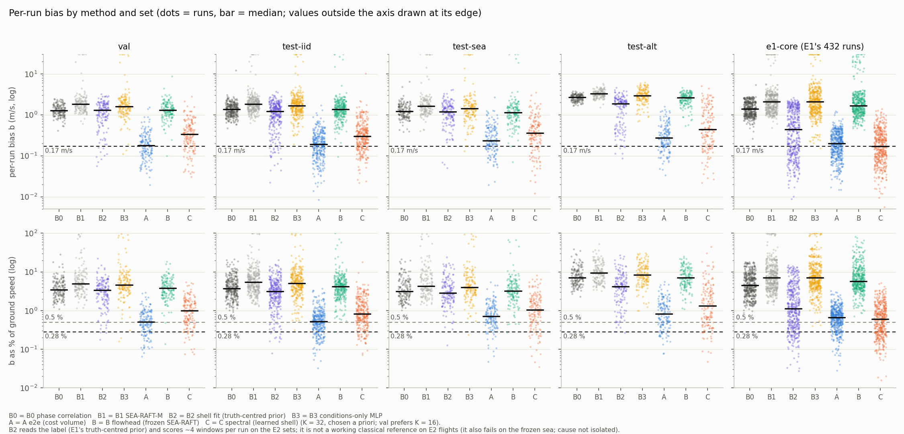
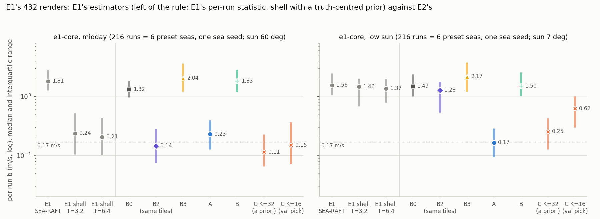
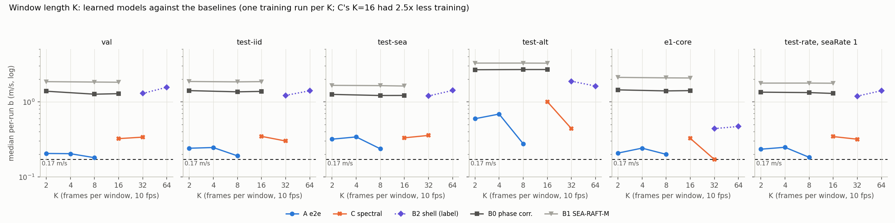
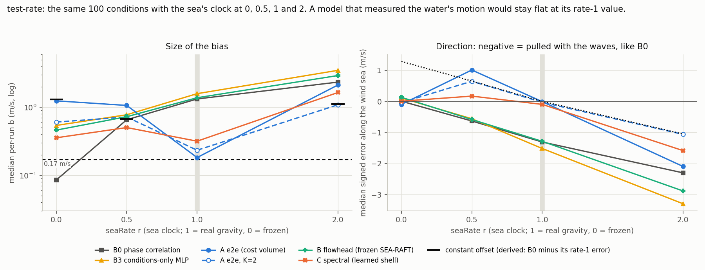
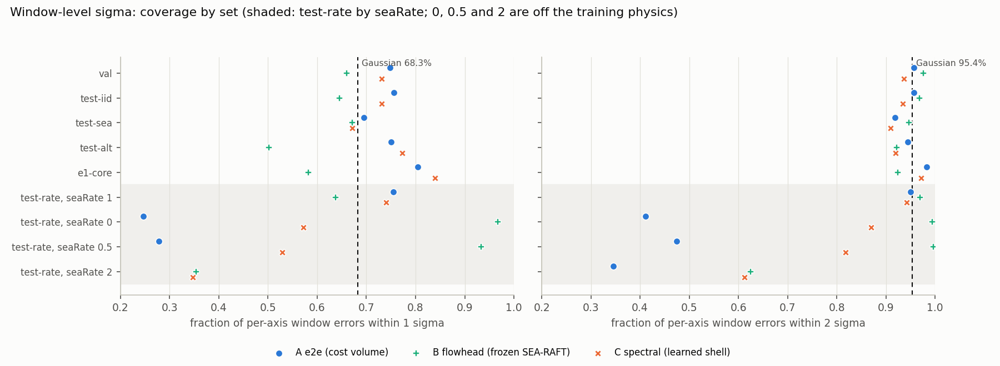
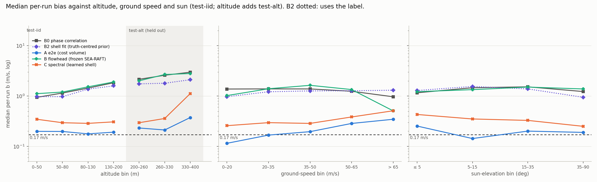

# E2 — can a network trained on simulated seas remove the waves' own motion?

Experiment E2 of [no-gnss-training-plan.md](../../../docs/no-gnss-training-plan.md), following
[E1](../../e1_wave_bias/results/RESULTS.md). Everything here is rendered by mare-realtime: **these
are simulated seas, and nothing in E2 has been run on real water.** Every number below comes from
a CSV in this folder or under `../verify/`, except the few marked *(NOTES)* or *(log)*, which come
from a method's NOTES.md or training log. The cross-method tables are written by
[`../analyze.py`](../analyze.py):

- `comparison_by_set.csv`, `comparison_by_slice.csv`, `e1_core_compare.csv`;
- `k_ablation.csv`, `rate_diagnostic.csv`, `calibration.csv`, `costs.csv`.

The audit's numbers (confidence intervals, like-for-like comparisons, per-sea tables, probes) are
written by [`../verify/audit_numbers.py`](../verify/audit_numbers.py) to `../verify/audit_out/`, and
by the scripts in `../verify/leak_audit/` to that folder (§5).

`analyze.py` reads the harness output (`<method>/<set>/per_run.csv`, `slices.csv`) and the prediction
CSVs that each method left under this folder. It recomputes every per-set row with the harness's own
`summarise` and stops if a value differs from the harness's `slices.csv`. Per-method details are in
`e2e/NOTES.md`, `flowhead/NOTES.md`, `spectral/NOTES.md` and `baselines/NOTES.md`. The independent
re-checks are in `../verify/`. Numbers marked *derived* are arithmetic on those CSVs, not read from
them.

**Statistic.** b is a run's bias: |mean over the run's windows of (v_est − v_true)|, in m/s. b% is b
as a percentage of the run's mean ground speed. "Median b" is the median over runs. The budget is
E1's 0.17 m/s: the water-motion share of a 0.5 % drift budget, equal to 0.28 % of speed at 60 m/s.
The tables also report b% ≤ 0.28 and b% ≤ 0.5. Bracketed ranges [lo, hi] are 95 % bootstrap intervals
over runs (`../verify/audit_out/bootstrap.csv`), or over seas where marked. **Every model is a single
training run with one seed**, so no interval covers training-run variation.

## 1. Question and answer

**Question (the user's hypothesis).** Can a network trained on simulated sequences learn to remove
the waves' own motion *implicitly*, and output the aircraft's velocity over the water, well inside
0.17 m/s? Does it hold outside its training conditions? The sim has no current, so velocity over the
water equals ground velocity.

**Answer, in five points.**

1. **Mostly, on simulated water, but not inside the budget.** Model A (`e2e`) is an end-to-end network
   over 8 rectified frames (0.7 s). On test-iid its median per-run bias is **0.191 m/s
   [0.178, 0.202]**. On the same runs, phase correlation (B0, K = 8) gets 1.356 m/s and frozen
   pretrained SEA-RAFT-M (B1) gets 1.841 m/s. A removes about 86 % of B0's median bias (*derived*).
   - **43 % [37, 49] of test-iid runs meet 0.17 m/s.** 19.7 % meet b% ≤ 0.28 and 48 % meet b% ≤ 0.5.
   - The p90 is 0.445 m/s, 2.6× the budget (*derived*).
   - Source: `comparison_by_set.csv`, `../verify/audit_out/bootstrap.csv`.
2. **On E1's own renders (e1-core), A beats the shell fit only in low sun; at midday the shell fit
   is better.** e1-core is **6 preset seas, all with one sea seed, × 72 flight and sun variants**:
   432 runs, but only 6 independent wave fields. The like-for-like reference is **B2**: E1's shell
   fit run on the same E2 tiles and scored with the same |mean| statistic. B2 keeps E1's
   truth-centred search prior, which favours it. E1's own numbers (its tiles, its per-run median
   statistic) are kept below only as a reference.

   | e1-core, median b (m/s) | all 432 | midday (216) | low sun (216) | b ≤ 0.17 | b% ≤ 0.28 | b% ≤ 0.5 |
   |---|---|---|---|---|---|---|
   | **B2: E1's shell fit on E2's tiles, E2 statistic (truth-centred prior)** | **0.439** | **0.145** | **1.275** | 34.3 % | 15.0 % | 29.2 % |
   | **A e2e, K = 8** | **0.199** | **0.230** | **0.165** | 42.6 % | 14.6 % | 34.3 % |
   | C spectral, K = 32 (*chosen a priori, not on val*) | 0.171 | 0.114 | 0.254 | 49.8 % | 27.1 % | 45.4 % |
   | C spectral, K = 16 (*the val-selected C*) | 0.325 | 0.150 | 0.622 | 32.6 % | 17.6 % | 28.9 % |
   | *reference:* E1 SEA-RAFT-M, g = 1 (E1 statistic) | 1.676 (414 runs) | 1.814 (198) | 1.556 | 0.2 % | 0.2 % | 0.2 % |
   | *reference:* E1 shell fit, T = 3.2 s (E1 statistic, truth-centred prior) | 0.614 | 0.237 | 1.461 | 23.6 % | 9.0 % | 19.0 % |
   | *reference:* E1 shell fit, T = 6.4 s (E1 statistic, truth-centred prior) | 0.645 | 0.206 | 1.366 | 25.0 % | 10.2 % | 20.1 % |

   Sources: `comparison_by_set.csv`, `e1_core_compare.csv` and
   `../verify/audit_out/e1core_like_for_like.csv`. The E1 b% shares are *derived* from E1's per-run b
   and the run's ground speed.

   - **Like for like, A is 2.2× below the shell fit overall (0.439 / 0.199, *derived*).** All of that
     advantage is low sun: A − B2 is −1.110 m/s [−1.271, −0.911] there.
   - **At midday A is worse than the shell (0.230 against 0.145, with the shell given a
     truth-centred prior).** Paired over the 216 midday runs, A − B2 = +0.085 m/s [0.049, 0.122],
     and A is better on only 38 % of them. A is also worse in all four midday altitude cells (Table 2).
   - **A and C do not differ significantly on e1-core.** With C at K = 32, A − C = +0.029 m/s
     [−0.007, 0.058], and C is better on 52 % of runs. The val-selected C (K = 16) gets 0.325, worse
     than A. C's K = 32 numbers are not a val-based choice (§3.2, §3.3).
   - **The 6 seas make these intervals too narrow.** Resampling whole seas instead of runs
     (`../verify/audit_out/e1core_cluster_bootstrap.csv`) gives A 0.199 [0.186, 0.218], C K = 32
     0.171 [0.118, 0.234], B2 0.439 [0.198, 0.610], A − C +0.029 [−0.016, 0.070] and midday A − B2
     +0.085 [0.059, 0.113]. With 6 clusters these intervals are themselves rough. Per sea
     (`../verify/audit_out/e1core_by_sea.csv`), the midday ordering holds in all 6 seas: A − B2 is
     +0.049 to +0.115, and A − C (K = 32) is +0.070 to +0.123.
3. **Held-out seas and altitudes cost A and C about the same in median, and cost A more in runs
   within budget.** Both stay far ahead of phase correlation and SEA-RAFT.

   | median b (m/s) [95 % CI] | val | test-iid | test-sea (wind 16–20 m/s or swell 14–16 s) | test-alt (220–400 m) |
   |---|---|---|---|---|
   | A e2e | 0.180 | 0.191 [0.178, 0.202] | 0.236 [0.199, 0.299] | 0.276 [0.230, 0.327] |
   | C spectral, K = 32 (a priori) | 0.338 | 0.300 [0.269, 0.331] | 0.356 [0.323, 0.443] | 0.438 [0.328, 0.613] |
   | C spectral, K = 16 (val-selected) | 0.323 | 0.346 | 0.331 | 1.001 |
   | B flowhead | 1.301 | 1.366 | 1.135 | 2.642 |
   | B0 phase correlation | 1.261 | 1.356 | 1.211 | 2.683 |

   - Against test-iid, the median rises by +24 % (test-sea) and +45 % (test-alt) for A, and by +19 %
     and +46 % for C (K = 32). A's p90 rises 54 % and 76 % (`../verify/audit_out/heldout_cost.csv`).
   - Within 0.17 m/s, A falls from 43 % to 30 % (test-sea) and 26 % (test-alt): −13 and −17 points.
     C (K = 32) falls by 1 and 2 points, to 23 % and 22 %.
   - test-alt is held out in camera height but **not in tile GSD for A**: A trained with 2 × 2 binning
     in 25 % of batches, which covers up to 0.655 m/px (*derived*: 2 × train's 0.328), beyond test-alt's maximum of
     0.642. C always
     trains with 2 × 2 binning (`spectral/training/k32/args.json`), so its effective GSD on test-alt
     (about 0.71–1.28 m/px, *derived*) lies outside its training range. The test-alt comparison
     between A and C is therefore not like for like.
   - B2 is left out of this table: on the E2 flights it is not a working classical reference
     (Table 1 note).
4. **"Implicit" here does not mean a measurement of the water's motion.** On test-rate, the same 100
   conditions are rendered with the sea's clock at 0, 0.5, 1 and 2.
   - A model that measured the water's own motion would keep its rate-1 error at every rate.
   - None does. A goes 1.242 / 1.063 / 0.182 / 2.123 m/s at rates 0 / 0.5 / 1 / 2.
   - C, which has √(g|k|) built in, goes 0.356 / 0.503 / 0.317 / 1.647 m/s.
   - **A (K = 8) removes most of the rate-1 bias, does not follow the water's motion at other rates,
     and its mechanism is not established.** Only the K = 2 and K = 4 ablations behave like a
     correction whose size is keyed to the waves' appearance, switched on by two-frame motion (§2.4).
   - Real water has one gravity, so this is not a failure on real seas by itself. It does tie the
     accuracy to how faithful the simulated wave field is (§2.4, §4.3).
5. **Model B fails at the task.** B is a learned head on frozen SEA-RAFT-M flow. Its median is
   1.07–2.64 m/s, no better than phase correlation, and its learned correction is worth about
   0.1 m/s (`flowhead/raw_vs_head.csv`). Fine-tuning SEA-RAFT's update block for 44 min (B-ft, the
   val-selected B) brought val to 0.985 m/s and test-iid to 1.076, still far from A or C.

*`fig_bias_by_set.png`: every run's b (top) and b% (bottom), per method and set, on a log axis, with
the 0.17 m/s, 0.28 % and 0.5 % lines. B2 reads the label (truth-centred prior) and scores about 4
windows per run on the E2 sets. On those sets it is not a working classical reference: it fails even
on the frozen sea, for a reason not isolated (Table 1 note).*

### Table 1. All methods, all sets (`comparison_by_set.csv`, main configurations)

Cells are median b (m/s) / p90 b / fraction of runs with b ≤ 0.17.

| method (K) | val | test-iid | test-sea | test-alt | test-rate (all 4 rates) | e1-core |
|---|---|---|---|---|---|---|
| **A e2e (8)**, 4 read-out iterations as trained | **0.180 / 0.438 / 0.47** | **0.191 / 0.445 / 0.43** | **0.236 / 0.687 / 0.30** | **0.276 / 0.786 / 0.26** | 1.077 / 2.687 / 0.12 | 0.199 / 0.453 / 0.43 |
| C spectral (32), *a priori, not val-selected* | 0.338 / 0.877 / 0.22 | 0.300 / 0.901 / 0.24 | 0.356 / 1.109 / 0.23 | 0.438 / 2.245 / 0.22 | 0.524 / 1.777 / 0.10 | 0.171 / 0.515 / 0.50 |
| C spectral (16), *val-selected* | 0.323 / 0.840 / 0.24 | 0.346 / 0.938 / 0.26 | 0.331 / 1.120 / 0.18 | 1.001 / 2.701 / 0.04 | 0.530 / 1.453 / 0.10 | 0.325 / 1.147 / 0.33 |
| B flowhead (8), cached head | 1.301 / 2.219 / 0.01 | 1.366 / 2.343 / 0.00 | 1.135 / 2.117 / 0.01 | 2.642 / 3.569 / 0.00 | 1.071 / 3.280 / 0.06 | 1.688 / 3.775 / 0.00 |
| B-ft (8), *val-selected B* | 0.985 / 1.808 / 0.02 | 1.076 / 2.086 / 0.01 | not run | not run | 0.822 / 2.612 / 0.07 | 1.341 / 3.254 / 0.00 |
| B0 phase correlation (8) | 1.261 / 1.982 / 0 | 1.356 / 2.071 / 0 | 1.211 / 1.993 / 0 | 2.683 / 3.209 / 0 | 0.945 / 2.635 / 0.20 | 1.394 / 2.426 / 0 |
| B1 SEA-RAFT-M (8) | 1.830 / 3.134 / 0 | 1.841 / 3.018 / 0 | 1.638 / 3.009 / 0 | 3.272 / 4.281 / 0 | 1.164 / 4.312 / 0.18 | 2.080 / 3.922 / 0 |
| B2 shell fit, **reads the label** (32) | 1.290 / 2.118 / 0.06 | 1.216 / 2.098 / 0.07 | 1.195 / 2.208 / 0.02 | 1.876 / 2.864 / 0.04 | 0.894 / 2.644 / 0.06 | 0.439 / 1.775 / 0.34 |
| B3 conditions-only MLP (8) | 1.605 / 3.076 / 0.01 | 1.666 / 3.287 / 0.00 | 1.432 / 3.164 / 0.01 | 2.958 / 4.793 / 0.00 | 1.317 / 4.114 / 0.04 | 2.102 / 5.650 / 0.00 |

Notes on the rows:

- **A**: strict val selection would use 2 read-out iterations, not 4 (§3.3). It would report test-iid
  0.187, test-sea 0.249, test-alt 0.271 and e1-core 0.206: within 0.013 m/s of the row above.
- **C**: K = 32 was chosen a priori; val prefers K = 16 (0.323 against 0.338). Both rows are shown.
- **B**: val prefers B-ft (0.985 against 1.301). The cached head stays the main B row only because it
  is the one B variant predicted on all six sets; B-ft was never run on test-sea or test-alt.
- **B2** is not a working classical reference on the E2 sets. Even with the truth-centred prior it
  gets 1.19–1.88 m/s on the rate-1 E2 sets, and on the frozen sea the static shell gets 0.277 against
  B0's 0.085 *(NOTES: `baselines/NOTES.md`, cause not isolated)*. The unlearned version of C's pipeline (C-classical)
  gets val 1.372. B2 also scores only about 4 windows per run on the E2 sets (600 windows on val's 150
  runs; 6 per run on e1-core), against 74 for A (`../verify/audit_out/per_run_from_preds.csv`), so its
  per-run |mean| is noisier and its p90 and in-budget fractions are not comparable. Do not read the
  E2-set columns as "far ahead of every classical method".
- Rows left out of this table (E1 UFM, C-classical, window RMS of every method) are in §6.

The same rows, as b% median / fraction with b% ≤ 0.28 / fraction with b% ≤ 0.5 / drift% median:

| method | val | test-iid | test-sea | test-alt | e1-core |
|---|---|---|---|---|---|
| A e2e | 0.51 / 0.21 / 0.49 / 0.50 | 0.53 / 0.20 / 0.48 / 0.53 | 0.71 / 0.09 / 0.29 / 0.75 | 0.82 / 0.13 / 0.31 / 0.82 | 0.67 / 0.15 / 0.34 / 0.67 |
| C spectral (32, a priori) | 1.00 / 0.09 / 0.25 / 1.05 | 0.81 / 0.10 / 0.24 / 0.99 | 1.05 / 0.13 / 0.23 / 1.36 | 1.32 / 0.10 / 0.25 / 1.39 | 0.60 / 0.27 / 0.45 / 0.60 |
| B flowhead | 3.76 / 0.01 / 0.01 / 3.73 | 4.21 / 0.00 / 0.00 / 4.13 | 3.24 / 0.01 / 0.03 / 3.25 | 7.07 / 0 / 0 / 7.02 | 5.77 / 0 / 0 / 5.81 |
| B0 phase correlation | 3.49 / 0 / 0 / 3.48 | 3.73 / 0 / 0 / 3.76 | 3.13 / 0 / 0 / 3.18 | 7.15 / 0 / 0 / 7.11 | 4.48 / 0 / 0 / 4.46 |

The drift% median tracks the b% median closely for A and B0, because a run's error is mostly a bias
shared by all its windows.

### Table 2. e1-core against E1, by sun and altitude (`e1_core_compare.csv`, median b in m/s)

Each sun × altitude cell holds 54 runs (9 per sea × 6 seas) and each speed cell 144, except where a
run count is given. B2 is the like-for-like shell (same tiles, same statistic).

| sun, altitude | E1 SEA-RAFT | E1 shell T = 3.2 | E1 shell T = 6.4 | B2 (label) | A e2e | C, K = 32 (a priori) | C, K = 16 (val) |
|---|---|---|---|---|---|---|---|
| midday, 30 m | 1.030 (36 runs) | 0.203 | 0.250 | **0.214** | 0.286 | 0.209 | 0.186 |
| midday, 60 m | 1.461 | 0.203 | 0.201 | **0.125** | 0.200 | 0.098 | 0.082 |
| midday, 120 m | 2.171 | 0.140 | 0.139 | **0.095** | 0.194 | 0.073 | 0.120 |
| midday, 250 m | 3.078 | 0.327 | 0.294 | **0.170** | 0.314 | 0.162 | 0.362 |
| low sun, 30 m | 0.925 | 0.708 | 0.958 | 0.608 | **0.221** | 0.324 | 0.314 |
| low sun, 60 m | 1.350 | 1.151 | 1.272 | 0.864 | **0.144** | 0.291 | 0.482 |
| low sun, 120 m | 2.049 | 1.579 | 1.569 | 1.475 | **0.156** | 0.263 | 0.697 |
| low sun, 250 m | 3.081 | 2.257 | 2.325 | 1.821 | **0.179** | 0.175 | 1.225 |
| all, 15 m/s | 1.676 | 0.277 | 0.285 | 0.181 | 0.125 | 0.142 | 0.265 |
| all, 30 m/s | 1.597 | 0.434 | 0.410 | 0.360 | 0.204 | 0.128 | 0.244 |
| all, 60 m/s | 1.800 (126 runs) | 0.894 | 0.873 | 0.649 | 0.333 | 0.255 | 0.454 |

Bold marks A against B2 only. The C-K16 column is from `../verify/audit_out/e1core_like_for_like.csv`.

**Caveats on this comparison:**

- E1's per-run value is a median over its windows, and its shell fit searched around the truth
  (truth + U(±5 m/s)). E2's b is the |mean| over every window, and A and C search nothing around the
  truth. B2 removes the first difference but keeps the prior.
- E1 SEA-RAFT's missing runs (midday 30 m, 60 m/s) are its collapse runs, so its cells there are
  flattered.
- **e1-core has 6 independent seas** (one sea seed; presets 12/0/11, 3/0/11, 7/0/11, 7/1.5/13,
  7/1.8/11 and 9.5/0/11 as wind m/s / swell height m / swell period s). Each sea is seen by 72 flight
  and sun variants. Run counts are not independent samples (§1 point 2, `e1core_by_sea.csv`).
- e1-core was rendered before the break-gate fix: its whitecap gate travels toward about 239° in
  every sea, which A and C never saw in training. It is also nadir, with no wind aloft and preset
  seas whose wind sea always travels toward 60°.
- A and C are E2 models run on E1's renders, not on E1's tiles. C's (K = 32) midday cells
  (0.073–0.209) are the best e1-core numbers in E2, but K = 32 was not chosen on val. Read them as
  "the learned shell works where the shell physics is cleanest", not as the headline.

*`fig_e1_core.png`: median and interquartile range of per-run b on e1-core, midday and low sun. E1's
estimators are left of the rule. Both C variants are shown.*

## 2. Does it read the waves, or something else?

### 2.1 It is not a conditions-only correction (B3)

B3 is an MLP that corrects B1's SEA-RAFT velocity from the gsd and the pattern velocity alone. It
cannot see the water, and it is selected on val. On the rate-1 E2 sets it removes 0.17–0.31 m/s of
B1's median (`comparison_by_set.csv`; for example test-iid 1.841 → 1.666); it is worse than B1 on
test-rate (by 0.153) and on e1-core (by 0.022). A is 8.7× lower on test-iid (1.666 / 0.191,
*derived*).

The tile orientation θ is random per run, so no average vector can be subtracted. The
train-mean constant (`B3-const`) equals B1 to within 0.02 m/s on every set (`comparison_by_set.csv`).
So **A's correction depends on the imagery**, and it removes something that varies with each run's
waves and direction.

### 2.2 Window length (K)

The figures below are median b in m/s, from `k_ablation.csv` and `comparison_by_set.csv`.

| K (T at 10 fps) | val | test-iid | test-sea | test-alt | e1-core | test-rate at rate 1 |
|---|---|---|---|---|---|---|
| A, K = 2 (0.1 s) | 0.205 | 0.241 | 0.317 | 0.594 | 0.207 | 0.233 |
| A, K = 4 (0.3 s) | 0.203 | 0.246 | 0.340 | 0.685 | 0.241 | 0.248 |
| A, K = 8 (0.7 s) | **0.180** | **0.191** | **0.236** | **0.276** | 0.199 | **0.182** |
| C, K = 16 (1.5 s), val-selected | 0.323 | 0.346 | 0.331 | 1.001 | 0.325 | 0.344 |
| C, K = 32 (3.1 s), a priori | 0.338 | 0.300 | 0.356 | 0.438 | 0.171 | 0.317 |
| B0, K = 2 / 8 / 16 | 1.381 / 1.261 / 1.280 | 1.407 / 1.356 / 1.373 | 1.252 / 1.211 / 1.214 | 2.668 / 2.683 / 2.685 | 1.439 / 1.394 / 1.407 | 1.341 / 1.324 / 1.290 |

**Two frames already remove most of the bias.** A at K = 2 gets test-iid 0.241, against 1.407 for
phase correlation on the same pairs. Two frames do carry motion information: on the frozen sea, K = 2
switches its correction off (paired change against B0 −0.053 at r = 0, `rate_diagnostic.csv`), while
the waves' appearance is the same at every sea rate. So the wave-induced shift between two frames
tells it *whether* to correct. What the data support is that the *size* of K = 2's correction is
keyed to what the waves look like (wavelength, orientation, shape), mapped through what the network
learned about this simulator's seas, while two-frame motion decides whether to apply it (§2.4).

**Longer windows help mostly out of distribution.** In distribution, K = 8 gains 0.05 m/s of median
over K = 2 (test-iid, *derived*). On test-alt it halves the median (0.594 → 0.276), and on test-sea it
cuts 0.08 m/s.

At window level K matters in distribution too. The verifier measured a median 2-D window error on
test-iid of 0.480 (K = 2) and 0.485 (K = 4), against 0.279 (K = 8). That is `calibration.csv`'s
`error_2d_median`: 0.480 / 0.485 / 0.279. K = 2's val window RMS in its training log is 4.15 m/s
*(log)*, against 0.61 for K = 8: gross outliers that the per-run median hides.

There is one training run per K and no seed repeats. The selected checkpoints saw different numbers
of windows: 100 800 (K = 8, step 6300), 67 200 (K = 2, step 4200) and 44 800 (K = 4, step 2800)
(`../verify/audit_out/k_ablation_windows_seen.csv`). K = 4 is not between K = 2 and K = 8: its
checkpoint was picked at step 2800 on a noisy val subset.

For C, K = 32 is better than K = 16 out of distribution (e1-core 0.171 against 0.325, test-alt 0.438
against 1.001). Val prefers K = 16 (0.323 against 0.338), and K = 16 had 2.5× less training
(`costs.csv`: 0.93 h against 2.35 h). So K and training time are confounded, and K = 32 was not a
val-based choice (§3.2). `spectral/NOTES.md` argues for K = 32 from the test sets; this document does
not adopt that argument.

*`fig_k_ablation.png`: median b against K per set, for A, C and the baselines.*

### 2.3 Held-out seas and altitudes

| | A | C (K = 32) | B0 |
|---|---|---|---|
| test-iid (300 runs) | 0.191 | 0.300 | 1.356 |
| test-sea, all (150) | 0.236 | 0.356 | 1.211 |
| test-sea, wind 16–18 / 18–20 m/s (train ≤ 16; 43 / 43 runs) | 0.261 / 0.304 | 0.394 / 0.523 | 1.133 / 1.170 |
| test-sea, no swell (held-out wind only, 21 runs) | 0.480 | 0.529 | 1.238 |
| test-alt, 200–260 / 260–330 / 330–400 m (37 / 57 / 56 runs) | 0.232 / 0.212 / 0.375 | 0.295 / 0.358 / 1.123 | 2.153 / 2.592 / 2.978 |

Median b in m/s, from `comparison_by_slice.csv`.

- **The cleanest held-out-wind slice costs A a lot.** On test-sea runs with no swell (only the held-out
  wind, 21 runs) A gets 0.480, 2.5× its test-iid value (*derived*). On test-sea at 0–50 m it gets
  0.477 (42 runs).
- In altitude, A gets 0.375 m/s at 330–400 m: 2.2× the budget (*derived*), with a b% median of 1.24.
  C breaks above 330 m (1.123).
- test-alt's tile GSD (0.354–0.642 m/px) lies entirely outside train's (0.043–0.328,
  `data_summary.csv`). A trained with 2 × 2 binning in 25 % of batches, which covers up to
  0.655 m/px (*derived*, 2 × 0.328; `e2e/NOTES.md`). So test-alt is held out in camera height but inside A's training GSD
  range. That choice was made from the set design, not from a test result. C always bins 2 × 2, so
  its effective GSD on test-alt (about 0.71–1.28 m/px) is outside its training range; C has no such
  cover.
- "Held out" here means held out *within the same renderer*: the same wave model, shading, foam and
  gate. It says nothing about generalisation to real water.

### 2.4 The sea-rate test: does it measure the water's motion?

test-rate renders 100 conditions four times with `render.seaRate` r = 0, 0.5, 1 and 2, with the same
seeds and the same θ. r scales the sea's clock, ω = r·√(gk), which is like gravity r²·g. r = 0
freezes the sea.

Three kinds of model give different responses:

- **A model that measures the water's own motion** and subtracts it would have about its rate-1
  error at every rate.
- **A model that subtracts a fixed rate-1 wave pull** — whether learned as a constant or as a prior
  keyed on the waves' appearance — would be exact at r = 1 and off along the wind elsewhere. Its
  signed along-wind error would be +1.285 m/s at r = 0, +0.654 at 0.5 and −1.050 at 2 (*derived*
  "constant offset" rows: B0 minus B0's own rate-1 error vector, same condition).
- **B0 itself** is pulled with the waves: −0.631 / −1.308 / −2.300 m/s at r = 0.5 / 1 / 2.

From `rate_diagnostic.csv` (100 runs per cell). The last column is the paired along-wind change
against B0 on the same run (method minus B0), with its 10–90 % range.

| method | r | median b | b ≤ 0.17 | signed along-wind median | median \|along\| / \|cross\| | change against B0, median [p10, p90] |
|---|---|---|---|---|---|---|
| B0 phase correlation | 0 / 0.5 / 1 / 2 | 0.085 / 0.654 / 1.324 / 2.342 | 0.80 / 0 / 0 / 0 | +0.006 / −0.631 / −1.308 / −2.300 | | 0 |
| constant offset (*derived*) | 0 / 0.5 / 1 / 2 | 1.297 / 0.675 / 0 / 1.120 | | +1.285 / +0.654 / 0 / −1.050 | | +1.308 [0.840, 2.082] at every r |
| A e2e K = 8 | 0 | 1.242 | 0.02 | −0.097 | 0.921 / 0.618 | −0.089 [−1.644, +1.663] |
| | 0.5 | 1.063 | 0.01 | +1.009 | 1.009 / 0.174 | +1.684 [0.760, 2.643] |
| | 1 | 0.182 | 0.46 | −0.008 | 0.084 / 0.119 | +1.272 [0.731, 2.055] |
| | 2 | 2.123 | 0 | −2.093 | 2.093 / 0.218 | +0.297 [−0.251, 0.751] |
| A e2e K = 2 | 0 / 0.5 / 1 / 2 | 0.605 / 0.720 / 0.233 / 1.087 | 0.14 / 0.02 / 0.36 / 0.02 | −0.038 / +0.646 / −0.029 / −1.061 | | −0.053 / +1.343 / +1.286 / +1.274 |
| A e2e K = 4 | 0 / 0.5 / 1 / 2 | 0.611 / 0.663 / 0.248 / 1.100 | 0.07 / 0 / 0.28 / 0.03 | −0.079 / +0.614 / −0.001 / −1.083 | | −0.077 / +1.260 / +1.306 / +1.275 |
| C spectral K = 32 | 0 / 0.5 / 1 / 2 | 0.356 / 0.503 / 0.317 / 1.647 | 0.13 / 0.08 / 0.18 / 0 | +0.005 / +0.169 / −0.097 / −1.584 | | −0.023 / +0.826 / +1.222 / +0.810 |
| B flowhead | 0 / 0.5 / 1 / 2 | 0.461 / 0.726 / 1.379 / 2.924 | 0.21 / 0.02 / 0 / 0 | +0.129 / −0.584 / −1.285 / −2.882 | | +0.117 / +0.069 / −0.034 / −0.616 |
| B3 conditions-only | 0 / 0.5 / 1 / 2 | 0.541 / 0.775 / 1.584 / 3.488 | 0.15 / 0.02 / 0 / 0 | +0.110 / −0.559 / −1.516 / −3.294 | | +0.118 / −0.030 / −0.256 / −0.990 |

What the data show:

- **No learned model measures the water's motion.** Every one is worst at r = 2. None stays near its
  rate-1 value.
- **A at K = 2 and K = 4 subtracts a fixed correction of about the rate-1 pull whenever the sea
  moves.** The paired change against B0 is +1.26 to +1.34 m/s at r = 0.5, 1 and 2, against the
  constant offset's +1.308. They switch it off when the sea is frozen (change −0.05 / −0.08 at r = 0).
  So they detect *whether* the water moves, but not *how fast*: the size of the correction is keyed
  to appearance, and motion decides whether to apply it.
  - The K = 2 / K = 4 NOTES called this "phase correlation minus a fixed correction". The
    independent check refuted that wording, because of the frozen-sea behaviour (§3.2).
- **A at K = 8 does not behave like that, and does not follow the sea's speed either.** Its paired
  correction *falls* as the true pull grows: +1.684, +1.272 and +0.297 at r = 0.5, 1 and 2.
  - At r = 0.5 it over-corrects: along-wind +1.009 and b 1.063, against 0.675 for the
    constant-offset model.
  - At r = 2 it keeps 91 % of B0's along-wind pull (−2.093 against −2.300, *derived*).
  - On the frozen sea its error is large (1.242 m/s). Its sign along the wind varies from run to run
    (paired change p10 −1.64 to p90 +1.66), and much of it is across the wind (median |cross| 0.618).
  - The data do not establish a mechanism for this (§3.2). It removes most of the rate-1 bias and
    becomes erratic at other rates.
- **C has real-gravity dispersion built in**, so its response is by design: good at r = 1, failing at
  r = 2 (1.647). On the frozen sea it is 0.356, against B0's 0.085.
- **B and B3 move with the sea like B0.** Neither has learned a wave-dependent correction worth
  having.

So the user's hypothesis holds **in a narrow sense**: a network trained on sim learns to remove most
of the waves' motion implicitly, at the sea rate it was trained on. It does not measure how the water
in front of it moves. For the K = 2 / K = 4 ablations, the correction is an appearance-keyed prior
switched on by motion. For A at K = 8, the mechanism is not established. Neither is the dispersion
relation: what the network learned maps *this simulator's* spectrum, wave directions, shading and
discrete wave lattice onto a speed (§4.3). Only C has √(gk) built in. None of them can correct for
anything the sim does not contain: currents, wind drift, nonlinear waves.

*`fig_sea_rate.png`: median b (left) and signed along-wind error (right) against seaRate. The black
ticks and the dotted line are the derived constant-offset model.*

### 2.5 Uncertainty (σ)

Window-level calibration, from `calibration.csv`, computed from the prediction CSVs. Each cell gives
the fraction of per-axis window errors within 1σ / within 2σ; a Gaussian gives 0.683 / 0.954. The last
column is the Spearman correlation, over runs, between a run's mean σ and its b.

| set | A e2e | C spectral | B flowhead | A: Spearman(run σ, b) |
|---|---|---|---|---|
| val | 0.748 / 0.957 | 0.731 / 0.936 | 0.660 / 0.976 | +0.47 |
| test-iid | 0.756 / 0.957 | 0.731 / 0.934 | 0.645 / 0.968 | +0.45 |
| test-sea | 0.695 / 0.918 | 0.671 / 0.909 | 0.671 / 0.947 | +0.65 |
| test-alt | 0.751 / 0.944 | 0.773 / 0.919 | 0.502 / 0.922 | +0.57 |
| e1-core | 0.805 / 0.983 | 0.840 / 0.972 | 0.582 / 0.924 | +0.38 |
| test-rate, r = 1 | 0.755 / 0.950 | 0.740 / 0.942 | 0.638 / 0.970 | +0.42 |
| test-rate, r = 0 | **0.247 / 0.411** | 0.572 / 0.869 | 0.967 / 0.994 | **−0.65** |
| test-rate, r = 0.5 | **0.278 / 0.474** | 0.529 / 0.818 | 0.933 / 0.996 | **−0.72** |
| test-rate, r = 2 | **0.190 / 0.345** | 0.347 / 0.612 | 0.353 / 0.624 | **−0.67** |

- **In distribution and on held-out sets, A's σ is about right.** It is slightly wide at 1σ and right
  at 2σ, and it ranks runs by bias (Spearman +0.38 to +0.65).
- **On seas that move unlike the training seas, A's σ fails in the worst way.**
  - Coverage drops to 19–28 % within 1σ.
  - A's median σ stays at 0.40–0.51 m/s while its median window error is 1.25–2.29 m/s.
  - Over runs, σ is anti-correlated with the bias (−0.65 to −0.72): it is *more* confident on the
    runs it gets most wrong.
  - On a degenerate static input (one frame repeated), σ is about 0.24 m/s with a 38 m/s error (§4.3).
  - **σ is not an out-of-distribution alarm.**
- σ is per window. A run's error is mostly a bias shared by its windows, so σ/√n does not bound b.

*`fig_calibration.png`: coverage within 1σ and 2σ per set, for A, B and C, against the Gaussian
values.*

## 3. Where it fails, and what the independent checks found

### 3.1 Slices (`comparison_by_slice.csv`, median b in m/s)

*`fig_bias_vs_conditions.png`: median b by altitude (test-iid, then test-alt), ground speed and sun
elevation (test-iid).*

**Ground speed is A's main driver.** On test-iid:

| ground speed | ≤ 20 m/s (46 runs) | 20–35 (85) | 35–50 (94) | 50–65 (66) | > 65 (9, anecdotal) |
|---|---|---|---|---|---|
| median b | 0.115 | 0.167 | 0.196 | 0.286 | 0.345 |

On e1-core it is 0.125 / 0.204 / 0.333 at 15 / 30 / 60 m/s (144 runs each). A model whose error is a
fixed wave correction should not depend on speed. A's error grows with speed probably because fast
windows overlap less: at 30 m and 60 m/s the image moves about 124 px per frame (*derived* in
`baselines/NOTES.md`). As a share of speed it falls (b% 0.71 below 20 m/s against 0.49 at 50–65,
`comparison_by_slice.csv`). So in b% A is worst on *slow* runs. The > 65 m/s bin has 9 runs and is
not evidence of a trend on its own.

**Other A slices:**
- Low altitude in held-out seas: test-sea 0–50 m, 0.477 (42 runs).
- High wind with no swell: test-sea, 0.480 (21 runs).
- Low sun: test-iid sun ≤ 5°, 0.254 (29 runs); test-alt sun 5–15°, 0.409 (16 runs)
  (`../verify/audit_out/A_sun_slices.csv`).
- Altitude 330–400 m: test-alt, 0.375 (56 runs).

On test-iid, A is flat in altitude (0.177–0.199) and in gimbal pitch (0.179–0.203).

**C's failures (K = 32):**
- Low sun: test-iid ≤ 5°, 0.431 (29 runs).
- Above 330 m: 1.123 (56 runs; p90 2.84, `comparison_by_slice.csv`).
- Strong held-out wind: test-sea 18–20 m/s, 0.523 (43 runs).
- Fast runs: e1-core 60 m/s, 0.255 (144 runs).

**Catastrophic tails** (`../verify/audit_out/tails.csv`):
- B1 collapses to near-zero flow beyond about 120 px per frame. b > 10 m/s on 26 e1-core runs, all of
  them 30 m and 60 m/s (`../verify/baselines_out/b1_collapses.csv`). B inherits this where the
  per-frame shift passes its ±128 px phase-correlation wrap: e1-core p90 26 m/s at 30 m.
- **A has no run above 2.8 m/s on any rate-1 set** (worst 2.71, test-sea). Its worst set p90 is
  test-rate, 2.687 (3.240 at r = 2).
- **C inherits B0's gross failures where its phase-correlation centre fails.** Its stage-1 grid is the
  pattern velocity ± 6 m/s. C has 1 run above 10 m/s on test-iid (b = 10.22, a racetrack at 31 m and
  airspeed 56 m/s, where B0 gives 12.30) and 1 above 5 m/s on test-alt (5.10). 20 of 150 test-alt runs are
  above 2 m/s.

### 3.2 Independent verification

Each model was re-checked by a separate agent (`../verify/`). The checks were:

- reading the inference path for leaks;
- re-running inference from the frozen checkpoints;
- recomputing every headline number with code other than the harness.

**No leak was found in any method.** The models receive only the tiles with their mask, gsd and dt:

- A: tiles, mask, gsd, dt. Per-frame normalisation and GroupNorm / LayerNorm only (no statistics
  across samples); tile and mask edges are dropped from the correlations.
- B: the same, plus a phase-correlation shift computed from the tiles.
- C: the same, plus the tile-derived phase-correlation pattern velocity. The verifier recomputed it
  from the tiles to 1.4e-14 m/s. C's teacher forcing uses the target only in training and decays to
  0; prediction passes no target.

**Data checks** (`../verify/leak_audit/data_checks.txt` and the files named):
- Sets are disjoint in run id, trajectory seed and sea seed across all 8 sets, pilot included
  (`../verify/e2e_out/set_overlap.csv`, `../verify/flowhead_out/leak_sets.csv`).
- θ is uniform per set: KS p 0.15–0.83, except test-rate, which shares θ across a condition's four
  rates by design. |mean exp(i(θ − start heading))| is 0.014 in train.
- The mask carries almost nothing: 0.05 % of train cells are masked. corr(gsd, ground speed) is
  0.010 in train.
- **dt is a constant 0.1 s in every set.** A's dt conditioning was therefore never exercised, and A
  is untested at any other frame interval.
- The held-out sea regime is absent from train, val, test-iid, test-alt and test-rate (train max wind
  15.998 m/s, max swell period 13.999 s).
- Checkpoints predate every main test prediction, and no code path reads a test set before
  prediction.

**Geometry on the engine's own poses.** Frozen-sea renders (40 test-rate rate-0 runs and 40 e1-frozen
runs) were passed through A's loader with every dihedral augmentation, and an independent numpy phase
correlation between consecutive tiles was compared with the loader's augmented target
(`../verify/leak_audit/geom_check_summary.csv`). The relative error along v has median 0.0002–0.0031,
and |median| across v is ≤ 0.0009 for all 8 elements in both sets: the label equals the content
motion, with no sign, axis-swap or rotation error. This complements `tests/test_geom.py`, which uses
geom's own pose convention.

**Reproduction:**
- Re-inference reproduces the per-set medians to within 0.0004 m/s for A, 1e-4 for B and 1e-6 for C.
- B3 reproduces bit for bit, as do the B0, B1 and B2 subsets.
- The audit recomputed per-run b from the raw prediction CSVs for A, C, B0 and B2 on all six sets,
  independently of the harness; it matches exactly (`../verify/audit_out/per_run_from_preds.csv`).
- B's per-window outputs are not deterministic: same code and batch, up to 5.28 m/s on one val window
  (`../verify/flowhead_out/rerun_vs_reported.csv`). Run-level medians still reproduce.

**Claims refuted or not established, and what they change:**

| claim (source) | verdict | what it changes here |
|---|---|---|
| A at K = 2 / 4 behaves like "phase correlation minus a fixed correction" (`e2e/NOTES.md`) | **refuted** | It holds only on a moving sea. On the frozen sea the paired change against B0 is ≈ 0 (`rate_diagnostic.csv`: −0.053 / −0.077), so these models detect motion, though not its speed. §2.4 uses the corrected reading. |
| A at K = 8 "applies the training dispersion as a prior … on the frozen sea its error is large but not along the wind" (`e2e/NOTES.md`) | **not established** | The data support "does not track the sea's speed". The frozen-sea error is large along the wind on individual runs (median \|along\| 0.921) with varying sign. The mechanism is open. |
| A's estimate is equivariant to the tile's rotations / flips (extra probe; not claimed) | **refuted** | Applying a dihedral element changes the window estimate by a median 0.08–0.09 m/s, p90 0.20 (`../verify/e2e_out/window_forward_summary.csv`; 180 test-iid and 261 e1-core windows). Test-time averaging might help; it was not selected on val, so it was not used. |
| A keeps 4 read-out iterations "chosen on val" | **protocol caveat** | Full val prefers 2 iterations (0.167 against 0.180 for 4, `e2e/eval/iterations.csv`). 4 was kept as trained. That file scores all 5 read-out depths on every test set (§3.3). |
| B: smoke-test loss 5.9 → 0.94, b 1.92 → 1.51 (`flowhead/NOTES.md`) | **refuted** (numbers) | The actual values are loss 2.985 → 0.993 and b 1.599 → 1.509. The conclusion (the pipeline learns) stands. |
| B: the gain over plain SEA-RAFT comes from the head's weighting (`flowhead/NOTES.md`) | **not established** | Phase correlation alone at K = 8 is better than B on val, e1-core and test-rate. The gain is plausibly the phase-correlation initialisation. |
| C: K = 32 is the main model | **protocol caveat** | It was chosen a priori; val prefers K = 16 (0.323 against 0.338). Under strict val-only selection, C's e1-core value would be 0.325 (midday 0.150, low sun 0.622), not 0.171. Both are shown in §1, Tables 1 and 2, and §2.2. |
| C: fused cost volume 6.1 ms against 264 ms *(NOTES)* | unverifiable (no artefact) | The verifier's bench gives 8.1 against 352 ms on the shared GPU: the same order. |
| B2 against E1: medians "within 0.06 m/s" (`baselines/NOTES.md`) | **refuted** (slightly) | The static K = 32 case differs by 0.073. The cross-check of tile axes and sign still holds. |

### 3.3 Protocol

- The main models' training hyper-parameters were fixed before any test result. Model choices were
  made on val, with these exceptions:
  - **C's K = 32**, chosen a priori; val prefers K = 16 (§3.2).
  - **A's read-out depth.** `e2e/eval/iterations.csv` scores 5 read-out depths (init and iterations
    1–4) on val and on every test set: five scorings of one hyper-parameter on test. Strict val
    selection gives 2 iterations, which would report test-iid 0.187, test-sea 0.249, test-alt 0.271,
    test-rate 1.064 and e1-core 0.206, against 0.191 / 0.236 / 0.276 / 1.077 / 0.199 as reported
    (`../verify/audit_out/selection_alternatives.csv`). The differences are at most 0.013 m/s, and the
    reported depth (4) is the one the model was trained with, not one picked on test.
  - **B's main row** is the cached head; val prefers B-ft (0.985 against 1.301). Val-selected B would
    report test-iid 1.076, test-rate 0.822 and e1-core 1.341; B-ft was not run on test-sea or
    test-alt. Both are in Table 1.
  - **B2's settings** are E1's defaults.
- Every test set (test-iid, test-sea, test-alt, test-rate, e1-core) was predicted once per frozen
  checkpoint, on every window (step 1, min_valid 0). The harness ran with `--require-all`. The one
  exception is A's iteration read-outs above, which come from the same forward pass.
- **No test result was used for a choice in this document.** It reports every set for every main
  configuration, and next to each non-val choice the val-selected alternative.

## 4. Setup, departures, artefacts, cost and next steps

### 4.1 Setup (exact)

**Renders.** These are mare-realtime runs from `make_jobs.mjs` and `render_all.sh`; ranges are from
`data_summary.csv`.
- Camera: 720 × 1280 portrait, vfov 92°, fx = fy = 618.04, 10 fps.
- Runs: 8 s (81 frames) after an 8 s warm-up.
- Flight:
  - altitude log-uniform 30–200 m;
  - airspeed 15–60 m/s, with ground speed 2.7–79.1 m/s in train;
  - gimbal pitch −90° to −60°;
  - wind aloft (the aircraft crabs), turbulence and gimbal stabilisation as `randomRun` draws them;
  - flight patterns: straight, random, lawnmower, racetrack, orbit, figure-8.
- Sea and sky: random seas (wind 0–16 m/s, swell period ≤ 14 s in train), sun −4° to 65°.

| set | runs | windows at K = 8 | what differs |
|---|---|---|---|
| train | 4500 | 333 000 | — |
| val | 150 | 11 100 | own seeds |
| test-iid | 300 | 22 200 | own seeds |
| test-sea | 150 | 11 100 | held-out sea: wind 16–20 m/s, or swell 14–16 s |
| test-alt | 150 | 11 100 | altitude 220–400 m (tile GSD 0.354–0.642 m/px, outside train's 0.043–0.328) |
| test-rate | 400 | 29 600 | 100 conditions × seaRate 0, 0.5, 1, 2, paired, same θ |
| e1-core | 432 | 49 248 | E1's core runs: 6 preset seas with one sea seed × 72 flights; nadir, no wind aloft, 121 frames, the pre-fix break gate |

**Tiles and inputs.**
- Each frame is rectified with the *true* attitude and camera height onto the plane up = 0. The tile
  is 384 × 384 cells of gsd = run-mean height / fx.
- The tile is sampled at camera-relative offsets c_run + R(θ_run)(x, y), constant within a run. So the
  tile translates with the camera, and the water's content moves through it at −v plus its own
  motion.
- θ_run is uniform in [0°, 360°): no heading or world axis is available.
- Models may use only the tiles, their NaN validity mask, gsd and dt.
- Label: the mean camera velocity over the window, in tile axes (ENU kept).

**Models.** Parameter counts are *(NOTES)*.
- **A** (`e2e/`, 1.84 M parameters, K = 8):
  - a shared 2-D CNN encoder with FiLM on gsd and dt;
  - masked FFT cross-correlation cost volumes at 4 scales × every frame gap;
  - a fixed phase-correlation start, then 4 weight-shared transformer read-out iterations giving Δu
    and log σ.
  - 6412 steps of batch 16 (102 592 windows, *derived*) in 2.50 h, stopped by the time cap. The
    selected checkpoint is step 6300 (100 800 windows).
- **B** (`flowhead/`): frozen SEA-RAFT-M on gap {1, 2, 4, 7} pairs started from a phase-correlation
  shift, with a 2.05 M-parameter head that weights cells and pairs and adds a correction. The main
  head was trained on cached features (40 000 windows, 0.66 h).
- **C** (`spectral/`, 127 656 parameters, K = 32): the whitened 3-D spectrum of the stack, scored
  against the shell √(g|k|) − k·V on a grid of candidate V around the classical pattern velocity. A
  per-k MLP weights the wavenumbers and a CNN refines the cost volume. Tiles are always binned 2 × 2.
  2.35 h, 322 k windows.
- **Baselines:**
  - B0: masked phase correlation, the median over pairs;
  - B1: pretrained SEA-RAFT-M, the median flow;
  - B2: E1's shell fit, with E1's truth-centred prior;
  - B3: an MLP correction of B1 from gsd and the pattern velocity.

**Metrics.** These are the shared harness `e2.evaluate` described above, plus drift% over
non-overlapping windows, and b along / across the wind sea.

### 4.2 Departures from the design, and why

- **B2 reads the label.** It keeps E1's truth-centred search prior, to compare with E1 like for like.
  It is not an estimator. It also scores one window per 16 frames, not every window, and it fails on
  the E2 flights (Table 1 note).
- **C's main K was chosen a priori, not on val** (§3.2).
- **A's training was cut by its 2.5 h cap while val was still improving slightly.** The val-subset
  median went 0.177 (step 4200) → 0.170 (step 6300, the selected checkpoint) → 0.171 at the last
  step, 6412 (`e2e/train/log.csv`).
- **All three of C's runs were under-trained.** Their best epoch was their last.
- **B's selection rested on the cached-val subset.** Its test predictions started before its full-val
  number came in; the full val then preferred B-ft (§3.3).
- **The K ablations are single runs, and their training budgets are not matched** at the selected
  checkpoints: 100 800, 67 200 and 44 800 windows for K = 8, 2 and 4 (§2.2). They also shared the GPU
  differently.
- **The GPU was shared by up to four agents' jobs throughout**, so wall times are not comparable
  across methods.
- **e1-core uses the pre-fix break gate.** The data agent's fix makes the gate travel downwind in the
  E2 sets. Before the fix it travelled toward about 239° (upwind for the presets), not toward 59° as
  first assumed.
- **B3 was trained on the first 1500 of the 4500 train runs**, for GPU time.

### 4.3 Simulator artefacts that may inflate the result

A sim-trained model can use any regularity of the renderer. The ones below exist only in the
simulator, or differ from real water. **Real seas will differ in all of them.**

The audit probed three of them directly (`../verify/leak_audit/cue_*`). The 32 windiest val runs
(wind ≥ 8 m/s) were re-rendered with one renderer change each, with θ matched. The control re-render
reproduces the val tiles bit for bit (`cue_tile_diff.csv`). Each change is scored paired against the
control on the same run (`cue_summary.csv`): the change in along-wind run error, median [p10, p90],
and the median change of the error vector.

| renderer change | change in the tiles | A, along-wind / vector | C (K = 32), along-wind / vector | B0 on pairs, along-wind / vector |
|---|---|---|---|---|
| foam drift set to 0 (it is 0.035·U10 downwind) | mean rel. diff 0.20, 73 % of pixels | **+0.017 [−0.003, +0.168]** / 0.027 | **+0.116 [+0.008, +0.404]** / 0.174 | +0.115 [−0.002, +0.324] / 0.145 |
| break gate frozen (speed 0) | mean rel. diff 0.30, 92 % of pixels | +0.001 [−0.034, +0.062] / 0.030 | +0.005 [−0.224, +0.210] / 0.201 | +0.001 [−0.279, +0.245] / 0.107 |
| break gate reversed (upwind) | mean rel. diff 0.29, 92 % of pixels | +0.008 [−0.028, +0.036] / 0.029 | −0.010 [−0.374, +0.144] / 0.190 | +0.007 [−0.116, +0.247] / 0.084 |
| cloud deck drift frozen | identical on 20 of 32 runs; up to 0.05 mean rel. diff on the rest | 0.000 [−0.004, +0.004] / 0.000 | 0.000 [−0.002, +0.005] / 0.000 | 0.000 [−0.000, +0.001] / 0.000 |

A second probe fed perturbed val windows (step 4) to the frozen A checkpoint
(`../verify/leak_audit/probe_a_summary_val.csv`). Unperturbed, its median b is 0.170, which matches the
training log's best val (0.1704), so the probe path equals the training path.

| perturbation of A's input | median b (m/s) | note |
|---|---|---|
| none | 0.170 | |
| frames shuffled | 37.5 | 0 % of runs within budget |
| frames reversed | 76.9 | estimated speed 39.5 against true 39.4: direction flipped, magnitude kept |
| one frame repeated K times (static) | 38.1 | estimated speed 1.86 against true 39.4, with σ 0.24 m/s |
| brightest 1 % / 5 % of cells clipped | 0.174 / 0.184 | A barely uses whitecap or glint peaks |
| ±30 % smooth brightness field (60 × 85 m pattern), moving at 8 m/s / fixed | 0.225 / 0.228 | illumination non-uniformity, absent from the sim tiles |
| high-pass: Gaussian low-pass (σ = 10 m) removed | 0.211 | σ rises to 0.41 |

A measures motion and frame order: it is not reading a static cue. On a static input its output is
not its learned correction (median cosine to A − phase-correlation start −0.13,
`probe_a_static_vs_correction.csv`).

| artefact | how it could inflate the learned models | evidence here |
|---|---|---|
| Linear waves on a discrete k lattice (1 km tile); ω quantised to 2π/1200 s; dispersion exactly √(gk) | A learned prior (A) or a built-in dispersion (C) is exactly right in the sim. A real sea has nonlinear and bound waves, currents (Doppler-shifted dispersion) and a wind-drift layer that no image method can separate from ego-motion. | test-rate shows the models depend on the sim's rate-1 motion (§2.4). Nothing here measures the cost of a mismatched spectrum. |
| Wave spectrum and directions from the sim's sampler; every preset wind sea travels toward 60° | A prior on how wave appearance maps to phase speed is tied to the sim's spectral shape and shading. | θ is random per run, so the world direction is not a shortcut. e1-core (presets) gives A 0.199 against 0.191 on test-iid, but e1-core differs in many ways (12 s runs with 114 windows against 74, nadir, straight, no wind aloft), so that comparison is weak. |
| Whitecap break gate: fixed 1.98 m/s scroll, downwind in the E2 sets | A known-speed pattern moving with the wind is a free velocity reference that a network could learn. | **Measured: not a shortcut for A.** Freezing or reversing the gate moves A's along-wind error by a median +0.001 / +0.008 m/s; a model using the gate as a 1.98 m/s reference would move by up to 3.96 m/s when it is reversed. C shows no systematic along-wind shift either, but its per-run error vector changes by about 0.19–0.20 m/s, the size of its budget. |
| **Foam drifts at 0.035·U10 with no Doppler shift; foam lifetime 2.4 s** | A known foam-vs-wave offset is a learnable cue that real foam (tens of seconds, riding a real drift layer) would not give. | **Measured: C leans on it, A only slightly.** With foam drift set to 0, C's along-wind error moves by a median +0.116 m/s (p90 +0.404), the size of its whole error budget; B0 moves by +0.115. A moves by +0.017 (p90 +0.168). C's accuracy therefore partly depends on a simulator law. Foam lifetime was not probed. |
| Shading model: sun, sky reflection, glint and low-sun shadowing as rendered | A learns how *these* waves look at each sun angle. Real low-sun imagery, exposure, compression, rolling shutter and lens effects are absent. | **Low sun is not settled.** A is no worse in low sun on e1-core (0.165 against 0.230 at midday, sun 5–15°), but on test-iid its worst sun bin is ≤ 5° (0.254, 29 runs, against 0.191 overall), and on test-alt its worst bin is 5–15° (0.409, 16 runs). |
| No illumination non-uniformity (vignetting, cloud shadow on the water) in the tiles | A real camera has both; the sim tiles do not. | A loses about 0.05 m/s under a ±30 % smooth brightness field (0.170 → 0.225 / 0.228, probe above). |
| Cloud deck motion | A moving cloud pattern (shadow or reflection) could be a reference. | Freezing the cloud drift left 20 of 32 runs' tiles bit-identical and changed the rest by up to 0.05 mean relative difference; no model's estimate moved (median 0.000). Clouds are not a cue here. |
| True attitude and height in the rectification | The deployed system will have estimated attitude and height. A height error scales the velocity directly. | Not tested. Every E2 number assumes perfect attitude and height. |
| Fixed frame interval | dt is 0.1 s in every set. | A's dt input was never exercised; A is untested at any other frame interval. |
| Fixed metric periods (foam patches, lace) | Hidden rulers for scale. | Not probed (sim-native ideas, idea 3). |

Foam covers 0.3–1.6 % of pixels in E1's renders *(E1 RESULTS)*.

### 4.4 Cost and reproducibility

**Box.** One RTX PRO 6000 Blackwell Max-Q (96 GB), billed at $5.33/h.

**Wall time** (`costs.csv`; dollar figures *derived* at that rate):
- Rendering all six E2 sets took 3.06 h (*derived*, sum of `render_wall_s`), about $16.
- Training runs, which overlapped on the shared GPU:
  - A: 2.50 h (K = 8), 1.62 h (K = 2), 0.95 h (K = 4);
  - C: 2.35 h (K = 32), 0.93 h (K = 16), 1.42 h (noreg);
  - B: 2.32 h on the fly, 0.65–0.67 h per cached head (plus about 46 min of feature caching
    *(NOTES)*), 0.74 h fine-tuning.
- The total box time of E2 is not recorded in any CSV. The agents' notes report about 4–4.5 h of
  billed idle time between training and evaluation, while their sessions were paused *(NOTES)*.

**Peak training GPU memory:** A 15.2 GB (K = 8), C 1.7 GB (K = 32), B fine-tuning 10.6 GB.

**Where things are:**
- Checkpoints are on the box under `/workspace/data/e2/<method>/`. Predictions are in
  `/workspace/data/e2/preds/` and harness output in `/workspace/data/e2/eval/`, with copies under
  this folder. The audit's cue renders are in `/workspace/data/e2/audit_leak/`.
- B's 26 GB feature cache (`/workspace/data/e2/flowhead/cache`) can be deleted.

**To reproduce:**
- Commands are in each method's NOTES.md and in [../README.md](../README.md).
- These tables: `uv run --no-project --with numpy --with pandas --with matplotlib python analyze.py`
  from `experiments/e2_learned_velocity/`.
- The audit's numbers: `uv run --no-project --with numpy --with pandas python verify/audit_numbers.py`
  (same folder). The cue probes: `verify/leak_audit/cue_render.sh`, `cue_rectify.py`, `cue_eval.py`
  (on the box).

### 4.5 Next steps

**Within the simulator** (cheap, and they decide whether the result is real or a sim cue):

1. **Remove the foam-drift dependence, then re-probe.** For C (and any future model), randomise foam
   drift speed and lifetime per run in training, or down-weight bright foam cells, and re-check with
   the paired foam probe (§4.3). Still unprobed: foam lifetime and the fixed metric periods scaled by
   ±30 % (sim-native ideas, idea 3).
2. **Train longer, with seeds.** A was still improving at its cap. Run three seeds of A at K = 8, plus
   K = 16, for error bars. Score test-time dihedral averaging on val (the verifier found A's estimate
   moves by a median 0.08 m/s under rotation). Add random smooth gain fields as an augmentation (A
   loses about 0.05 m/s to them).
3. **Force the measurement instead of the prior.** Train A on a mixture of sea rates (a gravity knob,
   idea 4) and check whether it then follows the water at every rate on test-rate. If it can, it is
   measuring the waves, and it would be less tied to the sim's spectrum. Combine it with C's
   dispersion layer, which is strong where the shell physics is clean (e1-core midday 0.114 at
   K = 32, chosen a priori; 0.150 at the val-selected K = 16) and weak at low sun and high altitude.
4. **Fix σ before relying on it.** Calibrate at run level, and add an explicit check that the observed
   spectrum lies on the expected shell, as an out-of-distribution flag.
5. **Use estimated attitude and height, and other frame intervals.** Rectify with an AHRS-like noisy
   attitude and a biased height, and measure the sensitivity; vary dt.

**What would have to be true for the real-flight step:**

- Real over-water flights with an independent reference (GNSS velocity used only for scoring), split
  by flight and frozen before scoring, as in plan §6.
- The real camera's imagery must be rectified with attitude and height the aircraft actually has,
  without GNSS. The E2 numbers assume the true ones.
- The real waves' appearance-to-speed mapping must be close enough to the sim's that A's learned
  correction transfers. Test this directly: run A and C on real footage, and check that B0's raw bias
  on the same footage (the wave pull, order 1–2 m/s in E1's sim) is removed by about the same factor
  as here.
- A current, or the wind-drift layer, will appear as a velocity offset that no image-only method
  separates from ego-motion (E4). A water-relative estimate is the most E2's approach can give.
- Real imagery differs in exposure, compression, rolling shutter, lens and illumination. Either render
  it or fine-tune with self-supervised losses on real pairs (plan §6 item 5).

Until then, E2 shows what sim training can reach on sim water: about 0.19 m/s median, 43 % of runs in
budget, tied to the simulator's waves, and for C partly to its foam.

## 5. Audit

An adversarial audit checked this document against the code and CSVs, and probed the models for
shortcuts. Its scripts and outputs are in `../verify/audit_numbers.py`, `../verify/audit_out/` and
`../verify/leak_audit/`. **No leak was found**: no path carries labels, position, speed, heading, run
or set identity into any model, so no training or evaluation was rerun. Every finding was re-checked
against the CSVs before it was applied.

**Fixed in this document (write-up only; no number in the CSVs changed):**

| finding | what changed |
|---|---|
| C's headline K = 32 is not the val-selected K | §1, Tables 1 and 2, §2.2, §3.2 and §4.5 show the val-selected K = 16 beside every K = 32 number. "C halves it" and "beat every E1 estimator" are gone. |
| A against C on e1-core is within noise | §1 point 2 gives the paired interval (A − C +0.029 [−0.007, 0.058]; by sea [−0.016, 0.070]). |
| A against the shell fit used a different statistic | §1 point 2 now uses B2 (same tiles, same statistic) as the reference: 2.2× like for like, not 3×; at midday the shell wins (0.145 against 0.230; paired +0.085 [0.049, 0.122]). |
| e1-core has only 6 independent seas | Stated wherever e1-core is described; per-sea table and cluster bootstrap added (`e1core_by_sea.csv`, `e1core_cluster_bootstrap.csv`, new code in `audit_numbers.py`). |
| "Held-out costs a little for A and more for C"; "modest loss"; "A holds to 400 m" | §1 point 3 and §2.3 rewritten from `heldout_cost.csv`: same relative median cost, A loses more runs within budget; no-swell slice 0.480 (21 runs); 0.375 at 330–400 m is 2.2× the budget. |
| test-alt is inside A's training GSD through binning, not C's | §1 point 3 and §2.3. |
| "Implicit learned prior" claimed for A at K = 8; "two frames cannot measure" | The appearance-keyed reading is limited to K = 2 / K = 4; A at K = 8's mechanism is "not established"; §2.2 uses the frozen-sea observation; "right physics in principle" removed (§1, §2.4, README). |
| Read-out depth scored on every test set; B's main row is not the val-best | §3.3 states it and lists the val-selected numbers; B-ft and C-K16 rows added to Table 1. |
| "A and C have no such collapse; worst p90 is test-alt" | §3.1 tails rewritten from `tails.csv`. |
| B2 presented as an optimistic reference | Table 1 note, figure caption and the figure's own footnote (`analyze.py`) say it is not a working classical reference on the E2 sets. |
| Low sun cited only from e1-core | §4.3 adds the test-iid and test-alt slices: low sun is not settled. |
| Slice cells without n; no intervals | n added to slice cells; bootstrap intervals added to §1; the 9-run speed bin marked anecdotal. |
| Six numbers that did not match their CSVs | B median range 1.07–2.64; B3's gain limited to the rate-1 sets; Spearman −0.72; final val-subset median 0.171 (0.170 at the selected step); 44 min. |
| K-ablation budgets "matched in windows seen"; e1-core as evidence about the gate | §2.2 and §4.2 give the windows seen at each selected checkpoint; §4.3 calls the e1-core comparison weak. |
| Numbers without a CSV source | Marked *(NOTES)*, *(log)* or *(E1 RESULTS)*; 0.71 / 0.49 / 2.84 cite `comparison_by_slice.csv`; omitted rows added in §6. |
| Foam drift "not probed"; gate "no gate-off render was made"; clouds as a possible cue | §4.3 reports the paired cue probes. |

**Checked, and corrected where the audit was wrong:**

- The audit said freezing the cloud drift left every tile bit-identical. It left 20 of 32 runs
  identical; the other 12 changed (8 by more than 1 % mean relative difference, up to 5 %,
  `cue_tile_diff.csv`). The models' estimates still did not move (median change 0.000), so the
  conclusion stands: clouds are not a cue.
- The audit said C-K16's low-sun failure holds in all 6 seas (0.59–0.84). It holds in 5; on the
  calm sea (3/0/11) C-K16 gets 0.201 in low sun (`e1core_by_sea.csv`).
- The audit's statement that the gate is "not a shortcut" holds for A. For C, the gate has no
  systematic along-wind effect, but it changes C's per-run error vector by about 0.2 m/s (§4.3).

**Checked, no change needed:** tile geometry, sign, rotation and augmentation on the engine's own
poses (`geom_check_summary.csv`, cited in §3.2 and the README); no input path for identity or
kinematics; A reads motion and frame order (§4.3); 711 of 717 quoted numbers reproduced before the
fixes, and per-run b recomputed from the raw predictions matches exactly.

**Not fixed (would need new renders or training, and none is a leak):**

- C was not retrained with randomised foam drift and lifetime: that needs a renderer knob, a
  re-render of train (about 3 h of rendering for the six sets) and a 2.35 h training, beyond this
  pass. C's numbers stand with the foam caveat in §4.3.
- A was not retrained with smooth gain-field augmentation.
- No seed repeats were run for any model; every interval here is over runs or seas only.
- B-ft was not run on test-sea or test-alt; A was not run at any frame interval other than 0.1 s;
  foam lifetime and the metric periods were not probed.

## 6. Rows left out of Table 1 (`../verify/audit_out/table1_appendix_rows.csv`)

Median b / p90 b / fraction b ≤ 0.17, and the median over runs of the window RMS error (m/s).

| method | set | runs | median b / p90 / ≤ 0.17 | window RMS median |
|---|---|---|---|---|
| E1 UFM refine, g = 1 (E1 statistic) | e1-core | 432 | 2.030 / 3.533 / 0.00 | — |
| C-classical (C's pipeline, unlearned shell objective) | val | 150 | 1.372 / 2.169 / 0.03 | 1.974 |
| C-classical | e1-core, every 10th window | 432 | 0.788 / 1.957 / 0.19 | 0.986 |

Window RMS median (`comparison_by_set.csv`, `rms_median`):

| method | val | test-iid | test-sea | test-alt | test-rate | e1-core |
|---|---|---|---|---|---|---|
| A | 0.387 | 0.342 | 0.630 | 0.355 | 1.493 | 0.287 |
| C (K = 32) | 0.659 | 0.595 | 0.806 | 1.034 | 1.010 | 0.366 |
| C (K = 16) | 0.792 | 0.744 | 1.009 | 1.480 | 1.001 | 0.633 |
| B | 1.549 | 1.605 | 1.564 | 2.741 | 1.252 | 1.864 |
| B-ft | 1.340 | 1.404 | — | — | 1.174 | 1.576 |
| B0 | 1.468 | 1.506 | 1.618 | 2.690 | 1.112 | 1.457 |
| B1 | 1.874 | 1.897 | 1.812 | 3.274 | 1.339 | 2.110 |
| B2 | 1.725 | 1.592 | 1.832 | 2.237 | 1.499 | 0.666 |
| B3 | 1.725 | 1.759 | 1.699 | 3.015 | 1.434 | 2.150 |
